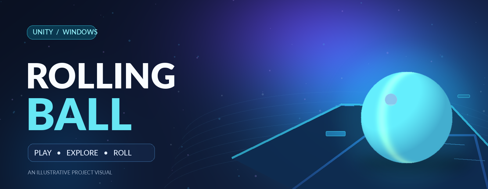
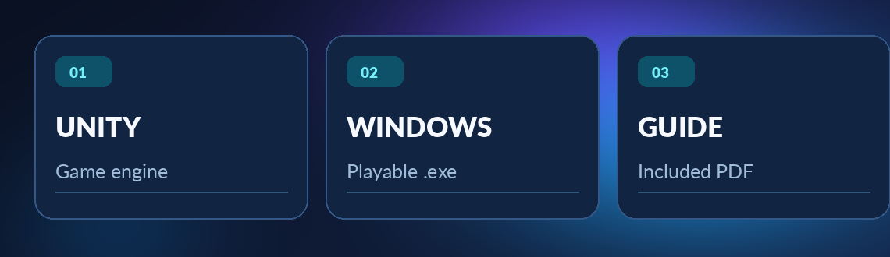
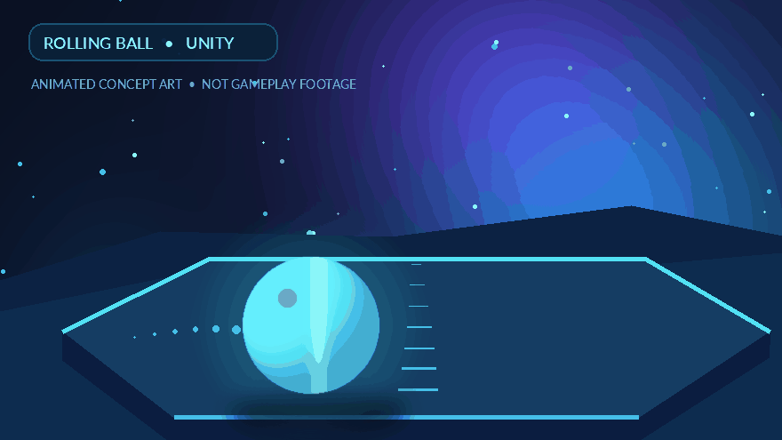

<div align="center">



<br />

[](https://git.io/typing-svg)

**A Unity-powered rolling-ball game, distributed as a playable Windows desktop build.**

[](https://unity.com/)


[](https://github.com/MMohamedHeshamm/Rolling-Ball-Game/stargazers)
[](https://github.com/MMohamedHeshamm/Rolling-Ball-Game/forks)
[](https://github.com/MMohamedHeshamm/Rolling-Ball-Game/commits/main/)

**[🎮 Get the Game](#-download--play)** · **[🎞 Animated Preview](#-animated-preview)** · **[📂 Files](#-repository-structure)** · **[👨‍💻 Developer](#-developer)**

</div>

---

## 🚀 About the Project

**Rolling Ball Game** is a **3D game created with Unity** and packaged as a standalone **Windows application**. Its central concept is a rolling ball in an interactive game environment, offering a simple entry point into a Unity-based desktop gaming experience.

This repository makes the **compiled, playable build** available to download and run. A PDF game guide is also included with the release files.

> **Repository status:** This is a *game distribution repository*, not a Unity source-code repository. The editable Unity project files and C# gameplay scripts are not currently included.

## ✨ Project Highlights

<div align="center">
  
</div>

- 🎮 **Rolling-ball game concept:** A 3D gaming experience centered on a moving ball.
- 🧩 **Built with Unity:** Distributed with the Unity desktop player runtime.
- 💻 **Windows-ready release:** Launch the game directly using `gameD1.exe`.
- 📖 **Included documentation:** Read `Game Guide.pdf` for game-specific instructions.
- 📦 **Complete build folder:** Runtime files are kept alongside the executable so the release can run correctly.

## 🎞 Animated Preview

<div align="center">
  
  <p><sub>Illustrative motion graphic created for this README — not captured gameplay footage.</sub></p>
</div>

> 📸 **Want to show the actual game?** Record a short screen capture while playing, export it as a GIF named `gameplay.gif`, and replace the image link above with `assets/gameplay.gif`. Actual footage is the best portfolio showcase.

## 📥 Download & Play

**Requirements:** A Windows computer capable of running this Unity desktop build. No separate Unity Editor installation is needed to launch the provided game.

1. Open the [Rolling-Ball-Game repository](https://github.com/MMohamedHeshamm/Rolling-Ball-Game).
2. Choose **Code → Download ZIP**, then extract the archive completely.
3. Keep `gameD1.exe`, `gameD1_Data/`, `MonoBleedingEdge/`, and the Unity DLL/runtime files together.
4. Double-click **`gameD1.exe`** to start the game.
5. Open **`Game Guide.pdf`** for the game-specific instructions and controls.

**Prefer Git?**

```bash
git clone https://github.com/MMohamedHeshamm/Rolling-Ball-Game.git
cd Rolling-Ball-Game
```

Then launch `gameD1.exe` from File Explorer on Windows.

> ⚠️ Do not move `gameD1.exe` out of its extracted folder on its own; Unity builds require their accompanying data and runtime files.

## 🗂 Repository Structure

```text
Rolling-Ball-Game/
├── gameD1.exe                  # Windows game launcher
├── gameD1_Data/                # Unity build data and content
├── MonoBleedingEdge/          # Unity runtime dependencies
├── UnityPlayer.dll            # Unity player library
├── UnityCrashHandler64.exe    # Unity crash handler
├── Game Guide.pdf             # Game documentation
├── README.md                  # This documentation
└── assets/                    # README visuals
    ├── rolling-ball-banner.png
    ├── rolling-ball-animation.gif
    └── project-highlights.png
```

## 🛠 Technology & Distribution

| Item | Details |
| :--- | :--- |
| **Engine** | Unity |
| **Type** | 3D desktop game |
| **Platform** | Windows |
| **Distribution** | Compiled `.exe` with Unity runtime/data files |
| **Documentation** | `Game Guide.pdf` |
| **Source code** | Not included in the current repository |

### 💡 Developer Note

For a code-review or developer portfolio, consider uploading the **original Unity project** separately (typically the `Assets/`, `Packages/`, and `ProjectSettings/` directories) if you still have it. This would let other developers inspect gameplay scripts and open the project in Unity. The existing `.exe` and runtime folders cannot substitute for the editable source project.

## 🌱 Future Documentation Improvements

- [ ] Replace the conceptual preview with recorded **in-game screenshots or gameplay GIFs**.
- [ ] Document the exact **keyboard/gamepad controls**, confirmed from the running game or guide.
- [ ] Add the **Unity Editor version** used to produce the game.
- [ ] Add the original Unity **source project** if available.
- [ ] Package versioned Windows builds under **GitHub Releases**.

## 👨‍💻 Developer

**Mohamed H. Eldesouky**

[](https://github.com/MMohamedHeshamm)
[](https://www.linkedin.com/in/mohamedhhh/)

---

<div align="center">

**⭐ If you enjoyed exploring the project, consider starring the repository!**

<sub>Rolling Ball Game · Unity · Windows</sub>

</div>
